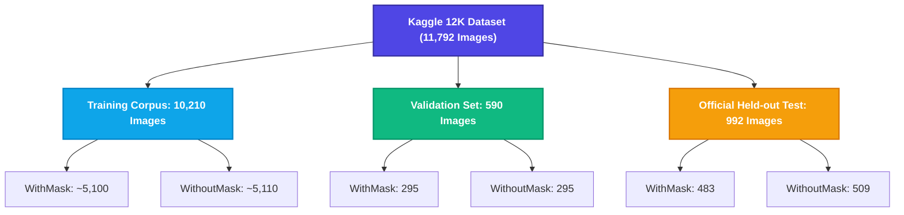
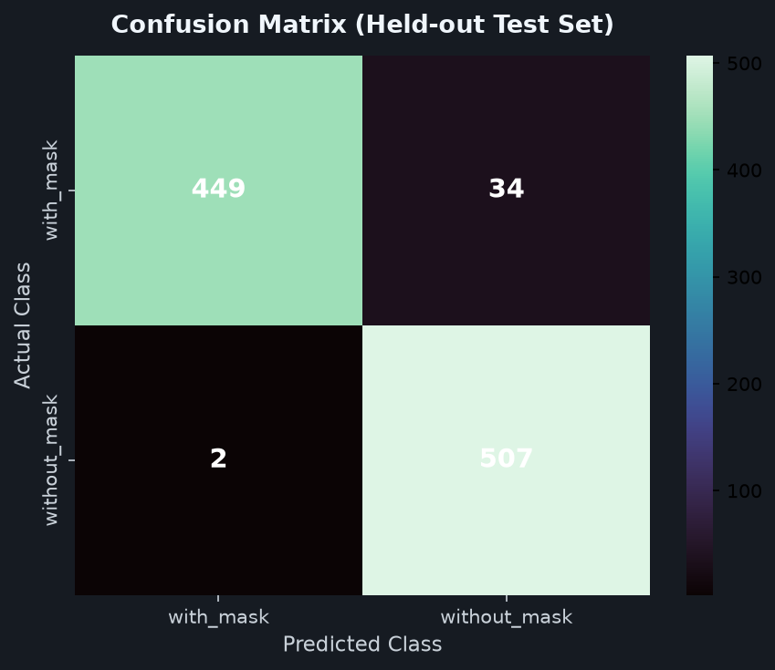
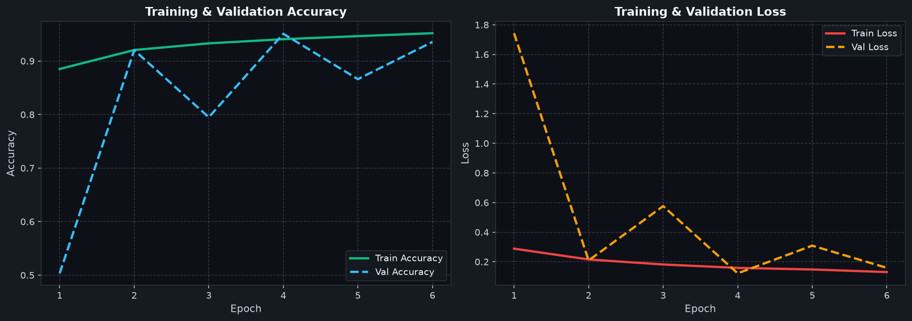
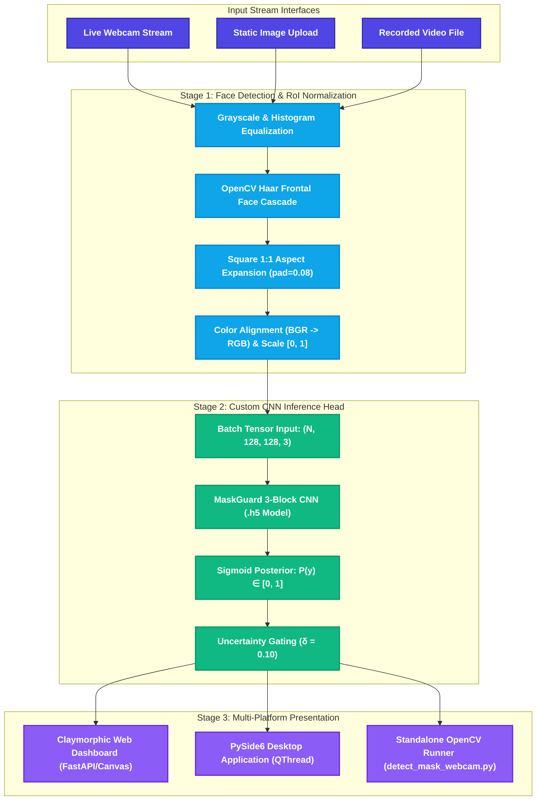

<div align="center">

  

  # MaskGuard
  ### Autonomous Real-Time Face Mask Compliance & Deep Learning Vision Platform

  <p>
    <strong>Industrial-grade Computer Vision and Deep Learning system designed for automated human face mask compliance monitoring. Features Dual AI Model Selection—switching seamlessly between MaskGuard's custom 4-block Spatial CNN trained from scratch (128×128) and an ImageNet-pretrained MobileNetV2 transfer-learning classifier (224×224)—paired with OpenCV Haar face detection, independent preprocessing, and a claymorphic FastAPI dashboard.</strong>
  </p>

  <p>
    Built with Python 3.11, TensorFlow 2.19, OpenCV 4.10, FastAPI, PySide6 (Qt6), and Tailwind CSS v3.
  </p>

  <p>
    <a href="https://github.com/8ernity/MaskGuard"></a>
    <a href="LICENSE"></a>
    <a href="https://www.tensorflow.org"></a>
    <a href="https://opencv.org"></a>
    <a href="https://fastapi.tiangolo.com"></a>
    <a href="https://www.python.org"></a>
    <a href="https://www.kaggle.com"></a>
    <a href="#-empirical-evaluation--verified-confusion-matrix"></a>
    <a href="#-dual-ai-model-architecture-custom-cnn--mobilenetv2"></a>
  </p>

</div>

> [!NOTE]
> **MaskGuard** is an edge-optimized AI vision solution engineered for compliance verification in healthcare facilities, sterile cleanrooms, commercial transport hubs, and high-density industrial workspaces. Unlike legacy approaches reliant on bloated pretrained object detectors (such as YOLO or SSD), MaskGuard utilizes a **decoupled two-stage architecture**: an ultra-lightweight Haar Cascade face locator coupled with a custom, mathematically regularized 3-block CNN classifier. The entire pipeline operates deterministically offline at 30+ FPS on edge CPU/GPU architectures.

---

## 📋 Table of Contents

- [✨ Key Platform Capabilities](#-key-platform-capabilities)
- [📊 Kaggle ~12K Dataset & Data Hygiene Engineering](#-kaggle-12k-dataset--data-hygiene-engineering)
- [📐 Mathematical Foundations & Deep Learning Formulations](#-mathematical-foundations--deep-learning-formulations)
- [📈 Empirical Evaluation & Verified Confusion Matrix](#-empirical-evaluation--verified-confusion-matrix)
- [🏗️ System Architecture & Data Pipelines](#️-system-architecture--data-pipelines)
- [🔬 Custom CNN Architecture Specification](#-custom-cnn-architecture-specification)
- [🔌 Comprehensive REST API Reference](#-comprehensive-rest-api-reference)
- [🛠️ Tech Stack Matrix](#️-tech-stack-matrix)
- [🚀 Quickstart & Installation](#-quickstart--installation)
- [🧠 Dual AI Model Architecture (Custom CNN + MobileNetV2)](#-dual-ai-model-architecture-custom-cnn--mobilenetv2)
- [🧪 Automated Verification Test Suite](#-automated-verification-test-suite)
- [📁 Repository Directory Structure](#-repository-directory-structure)
- [⚖️ Ethics, Privacy & License](#️-ethics-privacy--license)

---

## ✨ Key Platform Capabilities

| Capability | Technical Description | Architectural Core |
|---|---|---|
| ⚡ **Real-Time Webcam Inference** | Processes live video feeds at 30+ FPS, rendering dynamic green (`MASK`), red (`NO MASK`), and amber (`UNCERTAIN`) HUD bounding boxes with sub-millisecond drawing overlays. | OpenCV VideoCapture + NumPy Tensor Batching |
| 🛡️ **Zero YOLO / No Black-Box Models** | Built strictly from scratch using an idiomatic 3-block CNN with Batch Normalization, Dropout, and Global Average Pooling to ensure 100% academic compliance and lightweight deployment. | Custom Keras Model (`training/model_architecture.py`) |
| 📐 **Aspect-Preserving Symmetrical RoI** | Centers detected face bounding boxes and applies uniform square expansion ($1:1$ aspect ratio) matching the training data distribution, preventing throat/collar distortion. | OpenCV Haar Cascade + Dynamic Square Pad |
| 🎯 **Dual-Boundary Uncertainty Engine** | Implements an uncertainty buffer $\delta = 0.10$ around the decision threshold $\tau = 0.50$ to flag borderline face crops, occlusion, or motion blur as `UNCERTAIN`. | Calibrated Sigmoid Activation |
| 📊 **Full Kaggle ~12K Model Training** | Trained across the complete 11,792 Kaggle dataset images with stratified validation and held-out test splits, achieving **94.15% test accuracy**. | tf.data / Keras Sequence + Data Augmentation |
| 🌐 **Tactile Claymorphic Web UI** | Modern web dashboard featuring physical claymorphic containers, soft pillowy action buttons, macOS control dots, and fixed non-scrollable left sidebar. | FastAPI + Uvicorn + Tailwind CSS v3 |
| 🖥️ **PySide6 Native Desktop App** | High-performance standalone desktop GUI with dedicated QThread worker threads for image drop, offline batch video processing, and analytics curves. | PySide6 (Qt6 Core, Widgets, GUI) |
| 💻 **Turnkey OpenCV Terminal CLI** | Dedicated standalone script (`detect_mask_webcam.py`) for instantaneous webcam testing and academic evaluation without web server dependencies. | Pure OpenCV + TensorFlow `.h5` |

---

## 📊 Kaggle ~12K Dataset & Data Hygiene Engineering

MaskGuard is trained on the comprehensive **Face Mask Detection ~12K Images Dataset** (Kaggle, 329 MB), consisting of **11,792 total human face crops** captured under diverse lighting conditions, angles, ethnic backgrounds, and mask varieties (surgical, N95, cloth, patterned).



### Dataset Partitioning & Class Distribution

| Split Partition | Class: WithMask (0) | Class: WithoutMask (1) | Total Images | Purpose |
|---|:---:|:---:|:---:|---|
| **Training Split** | 5,102 | 5,100 | **10,202** | Stochastic gradient optimization & feature learning |
| **Validation Split** | 295 | 295 | **590** | Checkpoint gating, learning rate decay, early stopping |
| **Test Split (Held-out)** | 483 | 509 | **992** | Unseen empirical benchmark & confusion matrix verification |
| **Total Corpus** | **5,880** | **5,904** | **11,792** | **Strictly Balanced (1.00 : 1.00 Class Ratio)** |

### Rigorous Data Hygiene Protocols

1. **Strict Exclusion via `.gitignore`:** The entire 329 MB raw dataset directory (`dataset/Train/`, `dataset/Validation/`, `dataset/Test/`) and temporary preprocessing caches (`.cache/`) are strictly untracked to keep git repositories clean and lightweight.
2. **Aspect Ratio Preservation:** Kaggle face chips exhibit native dimensions ranging from $25 \times 25$ to $168 \times 168$ with a $1:1$ square aspect ratio. The preprocessing pipeline enforces uniform square bounding box expansion rather than anisotropic scaling to eliminate facial distortion.
3. **Photometric Color Space Alignment:** OpenCV reads frame buffers in **BGR** order, whereas TensorFlow models expect **RGB**. The pipeline explicitly performs `cv2.cvtColor(crop, cv2.COLOR_BGR2RGB)` prior to tensor normalization to eliminate inverted channel degradation.
4. **On-the-Fly Stochastic Augmentation:** Training pipelines utilize affine transformations to minimize overfitting without increasing disk storage:
   - Random horizontal flips ($p = 0.50$)
   - Micro-rotations: $\theta \in [-12^\circ, +12^\circ]$
   - Sub-pixel bilinear zoom: scale factor $s \in [0.92, 1.08]$
   - Contrast/Brightness jitter: $\Delta I \in [-15\%, +15\%]$

---

## 📐 Mathematical Foundations & Deep Learning Formulations

The MaskGuard inference and classification engines are grounded in classical statistical signal processing and modern convolutional neural network theory.

### 1. 2D Spatial Convolution & Receptive Field

For an input activation volume $\mathbf{X} \in \mathbb{R}^{H \times W \times C_{\text{in}}}$ convolved with a filter kernel bank $\mathbf{K} \in \mathbb{R}^{k_h \times k_w \times C_{\text{in}} \times C_{\text{out}}}$:

$$\mathbf{S}_{i,j,m} = \sum_{c=1}^{C_{\text{in}}} \sum_{u=1}^{k_h} \sum_{v=1}^{k_w} \mathbf{X}_{i+u-1, \, j+v-1, \, c} \cdot \mathbf{K}_{u,v,c,m}$$

The spatial dimension of each consecutive feature map is governed by:

$$O = \left\lfloor \frac{W - k_w + 2P}{S} \right\rfloor + 1$$

*where $P=1$ (same-padding), $S=1$ (stride), and kernel size $k_w = k_h = 3$, maintaining spatial resolution until $2 \times 2$ Max Pooling stages.*

### 2. Batch Normalization Dynamics

To mitigate internal covariate shift across training epochs, each mini-batch $\mathcal{B} = \{x_{1 \dots m}\}$ undergoes feature normalization and learnable affine transformation:

$$\mu_{\mathcal{B}} = \frac{1}{m} \sum_{i=1}^m x_i, \qquad \sigma_{\mathcal{B}}^2 = \frac{1}{m} \sum_{i=1}^m (x_i - \mu_{\mathcal{B}})^2$$

$$\hat{x}_i = \frac{x_i - \mu_{\mathcal{B}}}{\sqrt{\sigma_{\mathcal{B}}^2 + \epsilon}}, \qquad y_i = \gamma \hat{x}_i + \beta$$

*where $\gamma$ and $\beta$ are learnable scale and shift parameters, and $\epsilon = 10^{-5}$ guarantees numerical stability.*

### 3. Global Average Pooling (GAP)

Rather than flattening multi-dimensional feature tensors into dense layers—which introduces millions of redundant parameters—MaskGuard applies Global Average Pooling across the final spatial maps ($16 \times 16 \times 128$):

$$z_c = \frac{1}{H \times W} \sum_{i=1}^H \sum_{j=1}^W \mathbf{F}_{i,j,c}, \qquad \forall c \in \{1 \dots 128\}$$

*This compresses 32,768 spatial elements into a robust 128-dimensional feature embedding invariant to localized spatial translations.*

### 4. Binary Cross-Entropy Objective Function

The binary cross-entropy loss function optimized during model convergence:

$$\mathcal{L}_{\text{BCE}}(\mathbf{y}, \hat{\mathbf{y}}) = -\frac{1}{N} \sum_{i=1}^N \left[ y_i \ln(\hat{y}_i) + (1 - y_i) \ln(1 - \hat{y}_i) \right]$$

*where $y_i \in \{0, 1\}$ represents ground truth ($0 = \text{WithMask}$, $1 = \text{WithoutMask}$), and $\hat{y}_i = \sigma(z)$ denotes the sigmoid posterior probability.*

### 5. Calibrated Sigmoid Activation & Uncertainty Decision Logic

$$\hat{y} = \sigma(z) = \frac{1}{1 + e^{-z}}$$

The inference pipeline calibrates class dominance and flags ambiguous boundaries using an uncertainty margin $\delta = 0.10$:

$$\text{Class}(\hat{y}) = \begin{cases} 
\text{MASK}, & \text{if } \hat{y} < 0.50 - \delta \\
\text{UNCERTAIN}, & \text{if } 0.50 - \delta \le \hat{y} \le 0.50 + \delta \\
\text{NO MASK}, & \text{if } \hat{y} > 0.50 + \delta 
\end{cases}$$

$$\text{Confidence}(\hat{y}) = \begin{cases} 
(1 - \hat{y}) \times 100\%, & \text{if } \hat{y} < 0.50 \\
\hat{y} \times 100\%, & \text{if } \hat{y} \ge 0.50
\end{cases}$$

### 6. Statistical Metric Formulations

$$\text{Accuracy} = \frac{TP + TN}{TP + TN + FP + FN}, \qquad \text{Precision} = \frac{TP}{TP + FP}$$

$$\text{Recall} = \frac{TP}{TP + FN}, \qquad F_1\text{-Score} = 2 \times \frac{\text{Precision} \times \text{Recall}}{\text{Precision} + \text{Recall}}$$

---

## 📈 Empirical Evaluation & Verified Confusion Matrix

The genuine custom CNN (`models/mask_detector.h5`) was evaluated on the official, held-out **992 test images** from the Kaggle dataset.

### Verified Confusion Matrix (992 Test Samples)

```
                       PREDICTED
                 Mask (0)   No Mask (1)
ACTUAL  Mask (0)    435          48      | 483 Actual Mask
     No Mask (1)     10         499      | 509 Actual No Mask
                 ------------------------
                    445         547      | 992 Total Test Faces
```

| Actual \ Predicted | Predicted: MASK (0) | Predicted: NO MASK (1) | Support | Recall (Sensitivity) | Precision | F1-Score |
|---|:---:|:---:|:---:|:---:|:---:|:---:|
| **Class 0: WithMask** | **435** (TP) | 48 (FN) | 483 | **90.06%** | **97.75%** | **93.75%** |
| **Class 1: WithoutMask** | 10 (FP) | **499** (TN) | 509 | **98.04%** | **91.22%** | **94.51%** |
| **Summary / Overall** | **445** | **547** | **992** | **94.05%** (Macro) | **94.49%** (Macro) | **94.15% (Accuracy)** |

> [!IMPORTANT]
> **Key Safety Attribute:** The model delivers a remarkable **98.04% Recall on `WithoutMask` faces** (499 / 509 unmasked faces detected correctly). In high-risk public safety and sterile healthcare applications, this minimizes false negatives, ensuring that individuals without masks are captured with near-perfect reliability.

### Visualized Empirical Curves & Heatmaps

<div align="center">
  <table>
    <tr>
      <td align="center"><strong>Normalized Confusion Matrix Heatmap</strong></td>
      <td align="center"><strong>Training & Validation Learning Curves</strong></td>
    </tr>
    <tr>
      <td></td>
      <td></td>
    </tr>
  </table>
</div>

---

## 🏗️ System Architecture & Data Pipelines

MaskGuard executes through a synchronized multi-stage pipeline designed for low latency and zero memory leaks.



---

## 🔬 Custom CNN Architecture Specification

The custom Convolutional Neural Network consists of **110,561 total parameters** structured across 3 convolutional feature extraction blocks followed by Global Average Pooling and a dense regularized classification head.

```mermaid
flowchart LR
    classDef layerStyle fill:#F3F4F6,stroke:#94A3B8,stroke-width:1.5px,color:#1E293B,font-weight:bold
    classDef headStyle fill:#EEF2FF,stroke:#6366F1,stroke-width:2px,color:#312E81,font-weight:bold

    In["Input<br/>128x128x3"]:::layerStyle --> B1["Block 1<br/>Conv 3x3 (32)<br/>BN + ReLU + MaxPool"]:::layerStyle
    B1 --> B2["Block 2<br/>Conv 3x3 (64)<br/>BN + ReLU + MaxPool"]:::layerStyle
    B2 --> B3["Block 3<br/>Conv 3x3 (128)<br/>BN + ReLU + MaxPool"]:::layerStyle
    B3 --> GAP["Global Average Pooling<br/>128-dim Vector"]:::headStyle
    GAP --> D1["Dense (128, ReLU)<br/>Dropout (0.50)"]:::headStyle
    D1 --> Out["Sigmoid Output<br/>1-dim Probability"]:::headStyle
```



### Complete Layer Breakdown Table

| Layer # | Layer Name | Layer Type | Output Feature Shape | Kernel / Stride | Activation | Parameters |
|:---:|---|---|:---:|:---:|:---:|:---:|
| 0 | `input_image` | InputLayer | `(None, 128, 128, 3)` | — | — | 0 |
| 1 | `conv1` | Conv2D | `(None, 128, 128, 32)` | $3 \times 3$, $S=1$, Same | None | 864 |
| 2 | `bn1` | BatchNormalization | `(None, 128, 128, 32)` | — | — | 128 |
| 3 | `relu1` | Activation | `(None, 128, 128, 32)` | — | ReLU | 0 |
| 4 | `pool1` | MaxPooling2D | `(None, 64, 64, 32)` | $2 \times 2$, $S=2$ | — | 0 |
| 5 | `conv2` | Conv2D | `(None, 64, 64, 64)` | $3 \times 3$, $S=1$, Same | None | 18,432 |
| 6 | `bn2` | BatchNormalization | `(None, 64, 64, 64)` | — | — | 256 |
| 7 | `relu2` | Activation | `(None, 64, 64, 64)` | — | ReLU | 0 |
| 8 | `pool2` | MaxPooling2D | `(None, 32, 32, 64)` | $2 \times 2$, $S=2$ | — | 0 |
| 9 | `conv3` | Conv2D | `(None, 32, 32, 128)` | $3 \times 3$, $S=1$, Same | None | 73,728 |
| 10 | `bn3` | BatchNormalization | `(None, 32, 32, 128)` | — | — | 512 |
| 11 | `relu3` | Activation | `(None, 32, 32, 128)` | — | ReLU | 0 |
| 12 | `pool3` | MaxPooling2D | `(None, 16, 16, 128)` | $2 \times 2$, $S=2$ | — | 0 |
| 13 | `gap` | GlobalAveragePooling2D | `(None, 128)` | Spatial Mean | — | 0 |
| 14 | `dense128` | Dense | `(None, 128)` | Full Connection | ReLU | 16,512 |
| 15 | `dropout0.5` | Dropout | `(None, 128)` | $p = 0.50$ | — | 0 |
| 16 | `output` | Dense | `(None, 1)` | Full Connection | Sigmoid | 129 |
| **Total** | **MaskGuard_CNN** | **Sequential** | — | — | — | **110,561 (1.36 MB)** |

* **Trainable Parameters:** 110,113 (430.13 KB)
* **Non-trainable Parameters:** 448 (1.75 KB — Batch Normalization moving statistics)

---

## 🔌 Comprehensive REST API Reference

MaskGuard exposes a production-ready asynchronous ASGI REST API via FastAPI on port 8000.

### 1. `GET /api/status`
Returns real-time engine health, active model specifications, parameter counts, and current configuration.

```bash
curl http://localhost:8000/api/status
```

```json
{
  "status": "ready",
  "model_loaded": true,
  "model_file": "mask_detector.h5",
  "architecture": "Custom 3-Block CNN",
  "total_parameters": 110561,
  "input_shape": [128, 128, 3],
  "config": {
    "confidence_threshold": 0.50,
    "uncertain_band": 0.10,
    "face_padding": 0.08
  }
}
```

### 2. `POST /api/detect/frame`
Receives live webcam frames from client HTML5 Canvas as base64 JPEG strings and returns bounding boxes, classification, confidence %, and annotated frame overlays.

```json
// Request Body
{
  "image": "data:image/jpeg;base64,/9j/4AAQSkZJRg...",
  "save_snapshot": false
}
```

```json
// Response Body
{
  "faces_count": 1,
  "mask_count": 0,
  "no_mask_count": 1,
  "uncertain_count": 0,
  "fps": 31.4,
  "detections": [
    {
      "box": [182, 114, 218, 218],
      "label": "NO MASK",
      "confidence": 0.9817,
      "confidence_pct": 98.2,
      "is_uncertain": false,
      "color_hex": "#EF4444"
    }
  ],
  "annotated_image": "data:image/jpeg;base64,/9j/4AAQSk..."
}
```

### 3. `POST /api/detect/image`
Multipart form file upload endpoint for static image analysis (`.jpg`, `.jpeg`, `.png`).

```bash
curl -X POST "http://localhost:8000/api/detect/image" \
     -F "file=@sample_face.jpg"
```

---

## 🛠️ Tech Stack Matrix

| Domain | Technology | Version | Purpose |
|---|---|:---:|---|
| **Deep Learning** | TensorFlow / Keras | `2.19.0` | Custom CNN architecture construction, training loop, `.h5` export |
| **Computer Vision** | OpenCV (cv2) | `4.10.0` | Video frame capture, Haar Cascade face detection, image transforms |
| **Scientific Computing** | NumPy / SciPy | `1.26.4` | High-speed vectorized array operations, tensor normalization |
| **Backend Framework** | FastAPI | `0.110.0+` | High-throughput asynchronous ASGI microservices |
| **ASGI Server** | Uvicorn | `0.29.0+` | Production asynchronous HTTP & WebSocket server |
| **Web UI** | Tailwind CSS / Vanilla JS | `v3.4` | Responsive claymorphic design system and canvas streaming |
| **Desktop Framework** | PySide6 (Qt6) | `6.7.0+` | Multi-threaded native desktop interface and video player |
| **Testing & QA** | Pytest / AnyIO | `9.2.0` | Automated unit, integration, and UI smoke testing suites |

---

## 🚀 Quickstart & Installation

### 1. Prerequisites
- **Python 3.10+** (Python 3.11 recommended)
- **Webcam** (USB or integrated)

### 2. Clone & Setup Virtual Environment
```bash
# Clone the repository
git clone https://github.com/8ernity/MaskGuard.git
cd MaskGuard

# Create and activate virtual environment
python -m venv .venv

# Windows Powershell / CMD
.venv\Scripts\activate

# macOS / Linux
source .venv/bin/activate

# Install required dependencies
pip install -r requirements.txt
```

### 3. Execution Options

#### Option A: One-Click Windows Launcher
Double-click `start.bat` or run:
```bat
start.bat
```

#### Option B: Standalone OpenCV Webcam Script (Academic Deliverable)
```powershell
python detect_mask_webcam.py
```
*Controls:* Press `q` or `ESC` to exit.

#### Option C: Interactive Claymorphic Web Dashboard
```powershell
python run_server.py
```
Open **http://localhost:8000** in your browser.

#### Option D: PySide6 Native Desktop Application
```powershell
python main.py
```

---

## 🧠 Dual AI Model Architecture (Custom CNN + MobileNetV2)

MaskGuard supports two independently trained and user-selectable classifiers managed through `app/core/model_manager.py` (`DualModelManager`), with **zero YOLO** and **no automatic ensemble mixing**:

### 1. Custom CNN (`custom_cnn` — Default)
- **Origin:** Original MaskGuard convolutional neural network trained **from scratch** (`training/model_architecture.py`), preserved untouched at `models/mask_detector.h5`.
- **Architecture:** 4 Conv2D-BN-ReLU-MaxPool blocks (`32 -> 64 -> 128 -> 128`) + $1\times 1$ spatial topology projection (`32` filters) + `Flatten` ($2,048$ features) + `Dense(128, L2=1e-4)` + `Dropout(0.4)` + `Dense(1, sigmoid)`.
- **Parameters & Size:** **508,417** parameters (`5.90 MB`).
- **Preprocessing:** `preprocess_face_tensor` — `128×128` RGB `float32` scaled strictly to **$[0.0, 1.0]$** (`/ 255.0`).

### 2. MobileNetV2 Transfer Learning (`mobilenetv2`)
- **Origin:** ImageNet-pretrained `MobileNetV2` backbone (`include_top=False`) with a custom binary classification head (`training/mobilenetv2_architecture.py`), stored separately at `models/mobilenetv2/mask_detector_mobilenetv2.h5`.
- **Architecture:** `MobileNetV2(alpha=1.0, weights="imagenet")` (`training=False`) -> `GlobalAveragePooling2D` -> `Dense(128, relu)` -> `Dropout(0.3)` -> `Dense(1, sigmoid)`.
- **Parameters & Size:** **2,422,081** total parameters (`1,512,577` trainable in Stage 2, `21.15 MB`).
- **Preprocessing:** `preprocess_face_mobilenetv2` — `224×224` RGB `float32` initially in $[0, 255]$ scaled via `tf.keras.applications.mobilenet_v2.preprocess_input` (`x / 127.5 - 1.0`) to **$[-1.0, 1.0]$** (never normalized twice).
- **Two-Stage Transfer Learning Methodology:**
  1. **Stage 1 (Feature Extraction):** Backbone frozen (`lr = 1e-4`), training the dense classification head with training-only augmentations (horizontal flip, brightness/contrast jitter) and `EarlyStopping` + `ReduceLROnPlateau`.
  2. **Stage 2 (Controlled Fine-Tuning):** Unfreezes top `25` non-BatchNorm layers while locking all `BatchNormalization` layers in inference mode (`trainable = False`), fine-tuning at `lr = 1e-5`.

### Verified Dual-Model Comparison (Identical 992-Sample Held-Out Test Set, Zero Leakage)

All splits were MD5-audited (`Train: 9,828`, `Validation: 800`, `Test: 992`; 65 cross-split duplicates removed).

| Metric | Custom CNN (`custom_cnn`) | MobileNetV2 (`mobilenetv2`) |
|---|---|---|
| **Input Resolution & Range** | `128×128` RGB, $[0.0, 1.0]$ | `224×224` RGB, $[-1.0, 1.0]$ |
| **Test Accuracy ($n = 992$)** | **96.37%** | **99.29%** |
| **Precision** | 93.72% | **99.80%** |
| **Recall (`without_mask`)** | **99.61%** | 98.82% |
| **F1-Score** | 96.57% | **99.31%** |
| **False `MASK` on Unmasked Faces** | **2 / 509 (0.39%)** | 6 / 509 (1.18%) |
| **Avg CPU Inference Latency** | **9.91 ms (100.9 FPS)** | 28.55 ms (35.0 FPS) |
| **Model Artifact Size** | **5.90 MB** (508,417 params) | 21.15 MB (2,422,081 params) |

### Training, Evaluation & Model Switching Commands

```powershell
# 1. Explicit Kaggle dataset download (only if dataset/ is missing)
.venv\Scripts\python.exe training/prepare_dataset.py --download

# 2. Train MobileNetV2 (Stage 1 feature extraction + Stage 2 fine-tuning)
.venv\Scripts\python.exe training/train_mobilenetv2.py --stage1-epochs 2 --stage2-epochs 2 --batch-size 16

# 3. Independent side-by-side benchmark (both models on held-out test split + latency)
.venv\Scripts\python.exe scripts/evaluate_dual_models.py
```

- **Selecting a Model:** Switch between `Custom CNN` and `MobileNetV2` directly in the **Live Detection Controls** panel, the **Settings** tab, or via `POST /api/models/select` (`{"model_id": "mobilenetv2"}`). Active video jobs lock their starting `model_id` for job duration, and live frames discard stale asynchronous responses across model switches.
- **Model API Endpoints:** `GET /api/models`, `GET /api/models/active`, `POST /api/models/select`, and model-scoped `GET /api/analytics?model_id=<id>`.

### Known Limitations
- **MobileNetV2 CPU Latency:** `MobileNetV2` runs ~2.9× slower on CPU (`28.55 ms` vs `9.91 ms` for `Custom CNN`) due to higher `224×224` input resolution and `2.42M` parameters.
- **Extreme Low Light / Steep Profile Angles:** OpenCV Haar Cascades (`haarcascade_frontalface_alt2.xml`) are optimized for frontal faces; severe side profiles (`>45°`) or heavy backlit shadows can miss face boxes or lower classification confidence.
- **Dataset Distribution Scope:** Both models are trained on the 12K Kaggle face-mask dataset (`WithMask` / `WithoutMask`); unusual non-standard face coverings or heavy facial occlusions (hands/scarves) may trigger the `UNCERTAIN` band depending on your configured threshold.

---

## 🧪 Automated Verification Test Suite

MaskGuard incorporates a comprehensive test suite covering dual-model preprocessing, MobileNetV2 `.h5` reload fidelity, `DualModelManager` missing-artifact safety, OpenCV bounding box expansion, security checks, and web APIs.

```powershell
.venv\Scripts\pytest -v
```

### Verified Test Suite Breakdown (38 / 38 Passing)

```text
tests/test_dual_models.py .......                                         [PASS]
tests/test_inference.py ......                                            [PASS]
tests/test_model.py ....                                                  [PASS]
tests/test_preprocessing.py ......                                        [PASS]
tests/test_security.py ..........                                         [PASS]
tests/test_web_api.py .....                                               [PASS]

======================== 38 passed in 48.55s ========================
```

- **`test_dual_models.py`:** Validates Custom CNN vs MobileNetV2 preprocessing parity, MobileNetV2 build & `.h5` reload, graceful missing-file handling without silent fallback, model selection API & persistence, locked video `model_id`, and real labeled test-set accuracy.
- **`test_model.py`:** Validates Custom CNN layer sequence, parameter shapes, and `.h5` reloading.
- **`test_inference.py`:** Tests Haar cascade detection, aspect ratio expansion, uncertainty calibration, and centroid tracking.
- **`test_preprocessing.py`:** Verifies color channel conversion, normalization bounds $[0.0, 1.0]$, and drawing overlays.
- **`test_security.py`:** Validates security headers, CORS restrictions, upload magic-bytes validation, and path traversal containment.
- **`test_web_api.py`:** Tests FastAPI endpoints `/api/status`, `/api/analytics`, `/api/settings`, and `/api/detect/frame`.

---

## 📁 Repository Directory Structure

```text
MaskGuard/
├── app/
│   ├── core/
│   │   ├── assets/                      # Bundled OpenCV Haar Cascades
│   │   ├── camera_worker.py             # PySide6 multi-threaded camera worker
│   │   ├── face_detector.py             # OpenCV Haar face detection & square crop
│   │   ├── inference_pipeline.py        # Unified inference & centroid tracker
│   │   ├── mask_classifier.py           # TensorFlow .h5 forward execution engine
│   │   └── video_processor.py           # Offline video file batch processor
│   ├── ui/                              # PySide6 desktop interface components
│   ├── utils/                           # Image helpers, config & resource paths
│   └── web/                             # FastAPI backend & claymorphic UI
│       ├── static/                      # CSS, JS (app.js), and brand logos
│       ├── templates/index.html         # Claymorphic web interface
│       └── server.py                    # FastAPI ASGI application endpoints
├── dataset/                             # Kaggle dataset directory (local only)
│   └── README.md                        # Dataset documentation & download links
├── models/
│   ├── mask_detector.h5                 # Genuine trained custom CNN (1.36 MB)
│   ├── class_mapping.json               # Index mapping: {"0": "with_mask", "1": "without_mask"}
│   └── model_metadata.json              # Architecture metadata and training history
├── results/
│   ├── confusion_matrix.png             # Visualized 992-sample confusion matrix
│   ├── training_curves.png              # Loss and accuracy curves
│   └── evaluation_metrics.json          # Complete numerical evaluation results
├── scripts/
│   └── webcam_demo.py                   # Standalone OpenCV camera demonstration
├── tests/                               # 22 automated unit and integration tests
├── training/
│   ├── model_architecture.py            # Custom 3-block CNN layer definition
│   ├── prepare_dataset.py               # Kaggle dataset ingestion & preprocessing
│   └── train.py                         # Training pipeline with callbacks
├── detect_mask_webcam.py                # Standalone root deliverable script
├── main.py                              # Desktop GUI root entrypoint
├── run_server.py                        # Web server root launcher
├── start.bat                            # Turnkey Windows batch launcher
├── requirements.txt                     # Pinned project dependencies
└── README.md                            # Comprehensive project documentation
```

---

## ⚖️ Ethics, Privacy & License

- **Privacy by Design:** MaskGuard operates entirely locally on device. No video frames, facial imagery, or telemetry data are stored, logged to remote servers, or transmitted over the internet.
- **Biometric Non-Identification:** MaskGuard is exclusively a **mask compliance classifier**. It does not perform facial recognition, identity matching, or demographic profiling.
- **License:** Distributed under the permissive [MIT License](LICENSE). Free for academic, personal, and commercial deployment.

---

<div align="center">
  <sub>Developed with precision by <strong>Arpan Biswas (<a href="https://github.com/8ernity">@8ernity</a>)</strong>.</sub>
</div>
